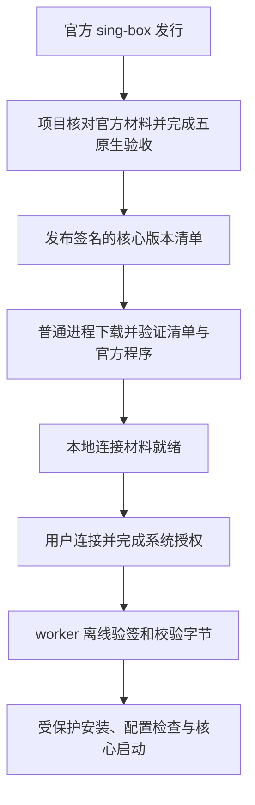

# 核心交付与受保护安装功能设计

状态：用户已确认，正在实现和验证；正式发行通过后删除本计划。本文件先定义用户行为、可信来源及维护边界，不列代码整改清单。

## 1. 判断：核心交付设计存在缺口

此次 1.14.5 连接失败发生在核心进程启动之前，与 Fake-IP、节点 IPv6 能力和 TUN 转发无关。403 是触发条件：目前只有 1.14.4 固定了官方元数据，后续版本首次准备受保护副本仍需要在线 GitHub API。

双副本本身有必要：普通用户可写的程序不能直接以管理员权限执行。问题是两份副本各自获取来源与安装材料，而产品只有一个“核心已就绪”，没有完整定义普通维护结束后到底能保证什么。

| 已追踪的位置 | 当前行为及含义 |
| --- | --- |
| `core/managed.rs` 的 `prepare_with`、`stage_archive` | 普通进程获取候选、下载、校验和解包；保留本地准备材料。 |
| `core/adoption.rs:219–239` | 提交已选版本后设置 usable，并提示“已就绪”；没有核对 worker 是否具备离线安装此版本的依据。 |
| `session/mod.rs:478–525` | 连接时验证普通副本，之后才向 worker 发起该版本的启动。 |
| `session/tunnel/worker.rs:587–643` | 已有受保护来源记录时核验并复用；没有记录时重新查官方发行、重新下载、解包并安装。 |
| `updates/release.rs:103–121` | 仅 1.14.4 使用包内元数据；1.14.5 等版本查询官方 API。Candidate 的结构检查不能使用户可写 JSON 成为管理员信任依据。 |
| `profile/tun.rs:9–20` | 接受 1.14.4–1.14.x 的能力范围；范围兼容不等于每个后续版本都已有完整交付材料和原生验收。 |
| `session/tunnel.rs:253–286` | 连接总等待有界；worker 准备失败有返回路径。此次诊断也观察到了失败提示，不能把“前端一直卡死”列为已证实缺陷。 |

上述 Rust 路径均相对 `src-tauri/src/`，行号为本次审查定位。现有合同见核心、软件更新及架构文档。

## 2. 本次要解决的完整问题

对受管核心建立一套完整交付：**版本可信材料和程序字节准备完成后，首次受保护安装也不需要在线查询核心发行信息或重新下载核心。**

“核心就绪”表示当前模式所需的本地程序和可验证来源材料齐全，可以进入系统授权与本地安装；它不表示管理员安装已经完成，也不表示节点外网可达。

保留以下产品边界：

- 核心独立于应用更新，可以在不升级桌面应用的情况下更新已兼容的核心。
- GUI 普通权限运行；只在用户连接时按需授权短期 worker，不为后台更新弹授权，不登记持久服务。
- 一个已选核心、至多一个上一版本、一个准备候选；普通副本与受保护副本是同一版本材料的不同安装位置，不新增两套用户版本选择。
- 核心、配置语义和网络转发仍由官方 sing-box 负责；外部核心及原始配置保持现有维护边界。

本设计只保证**核心供应环节**不依赖连接时的发行网络。规则缺失、用户配置远程资源、真实 DNS 与节点入口仍可能需要网络，不宣称整个连接可以离线建立。

## 3. 推荐：项目验证发布的核心材料

受管核心统一采用“Sing Shell 已验证的官方版本”。上游发布新版本后，由项目核对官方来源和五个平台的实际材料、完成适用的原生验收，再发布一份小型签名清单。应用在普通维护阶段取得清单及官方程序；worker 使用内置公钥独立验签，不需要再次向上游问询。

这会改变更新语义：**自动更新追随 Sing Shell 已验证版本，不再自动采用任意满足版本区间的上游新发行。** 上游版本与可更新版本可能有时间差，发布说明需如实说明。原始配置下的受管更新也使用同一来源，避免两套受管版本发现逻辑；用户管理的外部核心不受影响。

### 信任关系必须准确

这份签名是 **Sing Shell 对已核对官方材料的声明**，不是上游 sing-box 的原生签名。管理员侧信任依据从“连接当场请求官方 HTTPS API”改为“内置项目公钥验证的版本材料”。项目要承担核对、签名和密钥保管责任，不能把它描述成单纯增加缓存。

截至本次检查，官方 v1.14.5 的五个目标归档都有 GitHub 资产摘要；在该发行附件列表中未发现可直接用于本方案的独立归档签名文件。本方案不以存在尚未验证的上游离线签名机制为前提。

签名材料只表达一个版本、固定官方仓库、五个目标的原始资产身份、归档摘要/大小及从已验证归档提取的程序摘要/大小。程序摘要让 worker 可以复核传入的程序字节，不必重新下载归档。签名覆盖完整材料及格式/用途标识；版本、平台和应用能力范围仍须匹配。

不接受用户自填的摘要、公钥、仓库或执行路径。签名清单、普通安装文件和普通设置均可视为不可信输入，必须分别验证。所有受保护程序在完成字节验证前都不得执行，包括 `version` 和 `check`。

### 发布渠道保持专用且简单

- 使用现有 GitHub Actions / Releases 发布静态签名材料，不新增服务端、账户、token 配置或通用发布平台。
- 每个核心版本保留固定材料；一个固定 HTTPS 入口提供当前推荐材料。已选、上一版与候选各保存自己的签名材料，不依赖下次取到最新清单。
- 包仍取自官方发行，允许普通下载使用已有备用线路；字节和签名验证决定能否采用，线路不产生信任。
- 新桌面应用内置一个已验证基线版本的材料，作为普通引导来源；不再为 1.14.4、1.14.5 不断增加不同执行分支。
- 核心材料使用独立用途与密钥边界，不借应用安装接口安装核心，也不把核心签名用于应用更新。换钥通过正常应用更新携带新公钥；首版不建设远程密钥管理。
- 普通推荐变化不强迫已选版本联网重新认证；不自动降级。已有来源记录若出现同版本不同字节则拒绝替换。需要紧急撤销已批准版本时，以应用安全更新处理，不宣称离线程序能即时获知撤销。

## 4. 用户流程与状态

### 首次使用

应用在普通权限下准备基线或已验证新版。材料缺失、网络失败、签名不通过都显示在“核心与更新”页；仍能导入节点，但不能把缺材料状态显示成“核心已就绪”。

材料完成后提示“核心已就绪，首次连接需系统授权”。用户仍只选择节点、点击连接。worker 完成受保护安装和真实配置校验后启动；此阶段不查询 GitHub 核心发行、不联网下载核心。

### 后续核心更新

后台检查和准备不请求系统授权。当前可用版本在新版下载、验证、失败和取消期间保持可用；有效候选采用沿用现有停止、配置校验和偏好门禁。运行中的连接固定当前版本，待更新核心不混入节点替换。

材料齐全后可按现有自动更新约定在停止时采用，下次正常连接时授权安装新受保护副本。程序及签名材料作为一组保留；不能因下一候选覆盖单个归档缓存而丢失已选/上一版本的离线依据。

系统授权、磁盘写入、配置检查仍可能失败。“材料就绪”不能承诺这些操作一定成功。准备失败不消费新核心的首次启动试用，不把未启动的核心误记为崩溃或坏版本；保持当前已选材料、上一成功恢复依据及明确的失败阶段，不静默换版本。

### 状态只展示用户需要的信息

| 事实 | 展示与操作 |
| --- | --- |
| 缺少程序或有效来源材料 | 核心准备未完成；显示具体原因，使用现有“重试准备核心”。 |
| 新版准备失败，旧版本完整可用 | 更新未完成，当前核心仍可连接；重试继续新版准备。 |
| 连接材料已完整验证 | 核心已就绪；首次连接需系统授权，不声称受保护副本已经安装。 |
| 连接正在进行 | 按实际阶段显示“等待系统授权 / 正在安装核心 / 正在校验配置 / 正在启动网络”。 |
| worker 已确认运行与网络接管 | 显示实际核心版本和连接状态，不以请求回执或普通目录版本代替。 |
| 安装或检查失败 | 连接失败，保留具体原因；收尾完成后允许重试，未清理完继续阻止重入。 |

不新增“普通核心 / TUN 核心”两组设置、不新增独立安装按钮和高级信任开关。无需用户理解清单、缓存目录或 API 额度。原始错误仍可在本机诊断中查看，界面提示补上失败阶段。

## 5. 运行和权限边界

1. **普通维护负责完整交付材料。** 发现、下载、验签、包/原生架构/版本校验及候选恢复都在此阶段；失败不替换有效选择。
2. **worker 负责独立复核和受保护安装。** 复用现有认证通道接收受限材料；独立验签、核对本机目标、版本与字节，在受保护暂存区验证后发布。不能执行用户可写路径，不能把 GUI 的“校验成功”当作证据。
3. **已有受保护副本先本地复核。** 与所请求的固定材料一致即可复用，不在线刷新来源；损坏时从同一份有效本地材料重装，不在 root 内另起发行发现和下载链路。
4. **材料交接不扩大管理员接口。** 不接收任意管理员命令、目标路径或 URL；大小、总时限、取消、来源变化和中途字节变化均有边界。不通过放宽消息上限把整个程序塞入无界 JSON。
5. **生命周期保持现有合同。** 机器级独占、原连接候选失败保护、真实进程退出、一次回退、控制端失联清理及 macOS 短期授权继续保留。不后台重连、不静默提权。
6. **核心故障与连接故障分开。** 下载限流不触发核心试运行回退；安装失败与启动失败分别记录。取消和清理失败保留同一任务所有者，不能让迟到完成覆盖停止结果。

普通维护对来源的核验和 worker 对同一来源的核验仍是两次验证，但只获取一套材料。两份安装位置继续存在，重复联网和重复发行发现被移出连接链路。

## 6. 现有用户如何过渡

- 不重置节点、分流、Fake-IP 映射和网络偏好，不要求重新导入配置。
- 现有合法的受保护官方副本在核对旧的受保护来源记录、程序字节和版本后可以继续复用；不因为新签名材料尚未下载就破坏已有可信运行能力。具体旧记录转换在后续实现方案中定义。
- 普通目录中的 1.14.5 若匹配新应用内置或已发布的有效签名材料，可补齐依据并复用原字节；单凭旧 Candidate 或自报散列不能提升管理员信任。
- 本次是否发布 1.14.5 材料取决于其五原生验收；本次只检查了官方元数据，没有验证该版本运行能力。
- 若某个已选版本尚未批准、材料缺失且无可信受保护副本，保留文件和设置，说明该版本暂未具备受控 TUN 安装条件；不悄悄改为 1.14.4，不把它当作设置损坏。
- 修复核心准备不改变应用 updater、外部核心、原始配置语义或规则来源机制。实现后同步正式文档并删除本计划。

## 7. 备选与不采用的做法

| 方向 | 取舍 |
| --- | --- |
| 推荐：项目签名的已验证材料 | 保留独立核心更新、首次安装的离线验证和按需授权；需要维护一条专用签名发布流程，更新可能晚于上游。 |
| 更小的功能方案：TUN 核心固定随应用批准的版本 | 无需独立签名发布流程，首次仍需取得官方字节；新增 TUN 核心版本必须更新应用，会收缩当前独立核心更新能力。适合不愿承担签名渠道维护时选择。 |
| 把官方 API 查询挪到“准备 TUN 核心”操作 | 不改变官方在线信任模型，但每个新版本仍需额外授权并依赖 API；主要是把失败提前，不能兑现材料准备完成后的首次离线安装，操作也更复杂。 |

不采用：给 1.14.5 再硬编码一次、延长连接超时、扩大 403 重试、内置 GitHub PAT、无签名地缓存官方 JSON、相信本地版本输出或普通目录自报 hash、从镜像同时取包和唯一信任依据、恢复常驻 helper。它们分别留下后续版本同类故障、凭据负担或管理员执行信任缺口。

## 8. 验收结果必须能证明

| 场景 | 可验收结果 |
| --- | --- |
| 首次受保护安装 | 普通材料完整、受保护目录为空，封锁 GitHub API 和核心文件下载后，仍能授权安装指定版本并运行受控 TUN。 |
| 原缺陷 | 模拟 1.14.5 与下一受支持补丁版；上游返回 403 或读取中断，已完成交付的版本连接不受影响，无版本特例。 |
| 防止假离线测试 | 记录请求边界，证明 worker 未访问核心 API/下载端点，而不只是碰巧复用了测试机早已安装的受保护副本。规则和业务网络流量分别记录。 |
| 信任与字节 | 伪造/错用途签名、错平台/版本、包/程序篡改、传输中替换和链接路径全部拒绝，任何探测执行之前完成验证。 |
| 更新隔离 | 新版元数据/下载失败或被取消，旧版本仍能正常连接；“检查更新”不安装、不弹授权、不消费试用。 |
| 保留与恢复 | 下一候选准备及重启后，已选和上一版本材料仍齐全；旧保护记录和已有 1.14.5 按明确规则迁接，不能误初始化。 |
| 新程序故障 | 准备、安装、配置失败与真实启动失败正确区分；一次启动回退仍有界，恢复也不重新发现发行。 |
| 取消与退出 | 交接/安装期间停止、退出及控制端失联可以收尾；没有迟到启动、残留 helper 或第二个 TUN 所有者。 |
| 平台与发行 | Windows x64/ARM64、Linux x64/ARM64、macOS Apple Silicon 原生验证，再测试实际安装包、启动退出和升级；未执行范围单列。 |

## 9. 设计确认后才进入代码方案

首先确认是否接受“受管更新只采用项目验证版本”及项目签名责任。若接受，再针对一个受支持新版本验证小型签名材料、无网络的首次受保护安装和现有依赖可用性，之后定义具体模块与协议变更。

复杂度上限是一份专用版本材料、一套普通维护链路及一个受保护安装入口。不建设插件框架、通用包管理器、后台权限代理或多层更新渠道；默认不新增生产依赖。若签名实现确需新增依赖或无法保留现有权限边界，必须先修订设计，不能用自制密码学或信任普通缓存绕过。

未执行项：此次未在用户 Mac 复现 403、未运行 sing-box 1.14.5、未验证签名实现或原生安装；这里只依据所提供的诊断、当前源码和只读官方发行查询作设计判断。

官方参考：[sing-box v1.14.5 发行](https://github.com/SagerNet/sing-box/releases/tag/v1.14.5)、[GitHub REST API 限流](https://docs.github.com/en/rest/using-the-rest-api/rate-limits-for-the-rest-api)。
