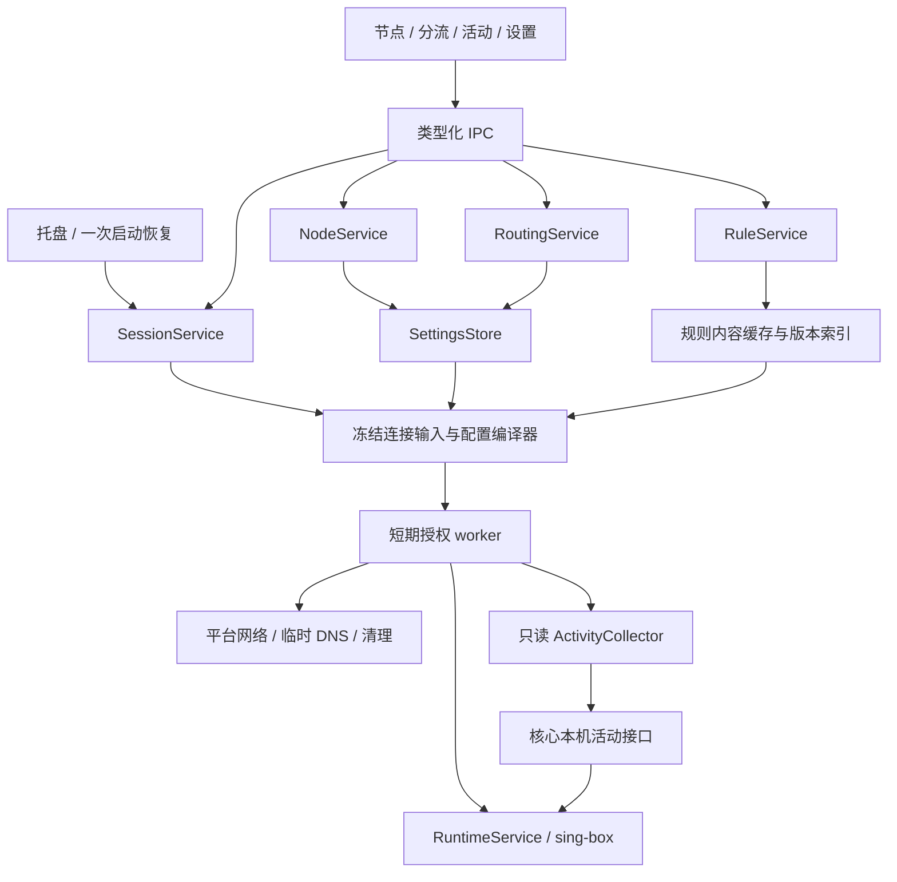

# 大版本重构方案：节点、分流、活动与设置

状态：实施中，代码与本机验证已推进，待五平台原生包验收和发布。日期：2026-11-27。

本次按一个完整的大版本收敛产品和代码模型，不在旧页面上继续堆按钮。允许重构前端组织、业务模型、IPC 和会话协议；不要求旧设置、旧 IPC、旧前端代码兼容。现有原始 sing-box 配置模式和外部核心能力仍然保留，它们是产品功能，不属于需要删除的历史兼容层。

本文统一替代此前 `routing-library.md` 草案。旧草案中的完整社区目录、固定分层优先级、仅手动更新、旧设置迁移和升级采用流程不再实施；固定来源、不可变版本、凭据保护和授权边界的有效约束在本文保留。

## 1. 总体决定

1. 前端改成“节点、分流、活动、设置”四个入口，只有设置展开二级导航。采用已确认的紧凑暖色侧栏方案。
2. 连接从“选择节点，再去运行页启动”改成单一 `connect(nodeId)` 用例。选节点、准备、切换、失败处理均由 Rust 会话层组织。
3. 分流采用一个有序规则数组。每个自定义规则可同时包含多个域名和 IP/CIDR，组内 OR，组间按顺序首次命中。默认规则唯一，固定末尾兜底。
4. 开源规则来自有限、随应用发布的来源目录，支持逐来源手动和自动更新。下载、验证、当前运行采用三个状态分开。
5. 活动来自官方核心连接接口与壳自身的结构化事件。原始日志保留为诊断材料，不通过解析所有日志或自己匹配流量来伪造结构化连接。
6. 保留已有核心管理、RuntimeService 进程所有者、平台网络清理、授权身份校验和应用更新器。重构它们与新业务的连接处，不借本次任务重写已经独立的系统适配。
7. 保持 Tauri 2、Rust、TypeScript 原生 DOM、Vite。无新增生产依赖；不引入数据库、前端框架、全局状态框架、通用任务平台或插件体系。

这里的规则组只是“共享一个出口的匹配条件集合”，不是多节点策略组。

## 2. 可验收的产品合同

### 2.1 节点

- 节点页首先呈现列表；导入使用模态框，粘贴与本地文件在同一流程中预览后提交。
- 节点支持多个文本标签。没有用户标签时归入“默认”；“默认”作为保底归属，不维护另一套全局标签实体。
- 标签筛选只影响列表，不影响连接。搜索只匹配公开摘要，不读取或搜索凭据。
- 每行有播放按钮。停止时直接连接对应节点；运行时点击另一节点启动切换；当前节点的停止按钮执行统一断开。
- 请求中的目标、当前实际运行节点分别显示。点击按钮后不立即把目标节点画成“使用中”。
- 节点名称和标签编辑使用小型模态框；首版不新增协议参数编辑器、节点测速、自动选节点或节点订阅。
- 导入不自动连接。节点列表的增删、重命名、标签操作不能隐式改变运行配置。
- 延续“运行期间不删除节点”的明确边界。停止并完成网络清理后才能删除；清除其恢复引用。名称、标签仍可编辑，且不触发待应用。

### 2.2 分流

| 对象 | 用户操作 | 执行语义 |
| --- | --- | --- |
| 自定义规则 | 命名；增加、编辑、删除多个域名与 IP/CIDR；设置出口、启用、顺序 | 任意匹配项命中即命中整组 |
| 开源规则 | 从固定目录添加；设置出口、启用、顺序；展开来源及更新设置 | 由指定版本的官方核心规则集匹配 |
| 默认规则 | 选择代理或直连 | 所有已启用规则均未命中时使用；不删除、不禁用、不拖拽 |
| 系统连接保护 | 查看说明 | DNS 接管、节点连通与本机/局域网保护固定在用户策略之前，不伪装成第二条默认规则 |

- “全部、默认规则、开源规则、自定义”是页内筛选，不是侧栏二级导航。
- 用户规则之间没有隐藏的“自定义优先”“直连优先”“域名更长优先”。跨组冲突一律服从可见顺序。
- 组内域名可分别选择精确匹配或包含子域名；包含子域名也匹配域名本身。IPv4、IPv6、单 IP 和 CIDR 均支持。
- 一个开源来源只添加一次。相同条件可以出现在不同自定义组中，由顺序决定先后；同组内规范化后的完全重复项报错。
- 名称、启停、出口作用于整组。不能在同一组内为不同匹配项设置不同出口。
- 默认出口初始为代理。新安装预置国内站点、中国大陆 IP 两条开源直连规则；其余来源由用户添加。初始没有自定义规则。
- 规则编辑模态框的“完成”只更新页内草稿；页面“保存规则”一次持久化整张表，避免模态框“保存”后又要求重复保存的歧义。
- 已保存内容在下次连接生效。运行中明确显示“待应用”，由“应用并重连”采用。自动更新规则文件也不自动重连或偷偷替换运行文件。
- 筛选状态下仍显示全局顺序号；排序按钮表示与相邻的可见规则交换全局位置，隐藏规则的相对顺序保持。页面明确“按完整列表优先级执行”。
- 筛选后的拖拽只重排可见规则占用的位置，隐藏规则留在原槽位；无筛选时就是完整列表移动。拖拽和键盘排序共用一个数组变换，默认规则不参与。

### 2.3 活动

- 展示当前会话、当前连接、上下行速率和本次累计量；连接列表展示目标、协议、出口、命中规则、流量和开始时间。
- 已知字段才展示。未知域名、进程、规则、结束原因用“未知/不可用”，不补成猜测值。
- 连接详情可展开；原始日志在详情或诊断入口查看。结构化事件单独展示启动、授权、切换、DNS 接管、清理、规则更新等结果。
- 第一版记录“本次已观测连接”，不承诺完整网络审计。短于采样间隔的连接可能没有记录，消失的连接不等于失败。
- 原始配置模式不改写用户配置来强加监控接口。若没有壳可安全使用的核心活动接口，保留会话事件和日志，明确显示“当前模式不提供连接明细”。

### 2.4 设置与模态框

- 设置只有“通用、网络、核心与更新、高级”四个二级入口。
- 通用：登录启动、一次运行恢复、窗口与托盘说明。沿用当前关闭到后台的产品合同，不因为原型中的示例开关而额外实现新的关闭模式。
- 网络：TUN 固定方式说明、下载网络设置、备用地址及诊断。逐来源规则自动更新仍在分流详情，不重复提供另一套总开关。
- 核心与更新：核心来源、核心维护、应用更新。当前运行版本与已准备版本分别呈现。
- 高级：原始配置模式、文件入口、诊断和原始日志。切换模式需先断开。
- 原始配置模式下，节点播放和分流应用明确不可用；全局状态区提供原始配置的校验/启动/停止，并指向高级设置的配置入口。恢复节点模式必须停止后明确切换，点击节点不能隐式更改运行模式或改写原始配置。
- 新增/编辑自定义规则、添加开源规则、导入节点、编辑节点名称/标签使用模态框。
- 规则详情、更新状态、活动详情、设置分类原位呈现；不为每次查看再弹窗。
- 使用一个模态框生命周期组件，管理焦点、滚动、关闭和结果；不做表单 DSL，不叠多层业务模态框。

### 2.5 不扩张的范围

本次不做节点订阅自动更新、测速、多节点出口、策略组、系统代理开关、按应用分流、广告拦截/拒绝动作、任意远端 URL、通用规则导入器、完整社区目录搜索、云同步、通用后台服务、崩溃重连、Clash 外部控制面板或网络断路保护。

规则库自动更新是本次明确增加的能力，与仍不支持的节点订阅自动更新区分。

## 3. 已追查的现有链路与整改原因

| 当前链路/位置 | 已确认的问题或限制 | 本次整改 |
| --- | --- | --- |
| `src/main.ts → core_snapshot → SessionService::snapshot_for` | 每 700 ms 读取含设置、节点、日志的整包快照，再驱动所有页面 | 分离慢变配置、轻量会话、分页活动和增量日志 |
| `src/profiles.ts` | 一个控制器同时持有节点导入票据、节点列表、分流草稿、运行模式和退出确认 | 按节点、分流、设置拆分；共享模态生命周期 |
| `profile_select_node → profile::Service::select → SettingsStore::profile` | 只是保存选择，真正连接仍由另一个命令触发 | `connect(nodeId)` 直接冻结并执行连接请求 |
| `SessionService::desired_connection/apply_owned` | 从可变全局设置重新组装候选；切换前后的准备和回退分布在控制端 | 固定输入后交给 worker 执行受控替换；回退只有一个所有者 |
| `SettingsStore::profile → routing.normalized` | 每次节点或分流写入都会按域名/IP/直连等再次排序 | 规范化只改值、去重校验，不改用户组顺序 |
| `profile/routing.rs::Rule` | 单条仅有一个域名或一个 IP，且动作附在匹配项上 | 匹配条件归组，出口/启用/顺序归组 |
| `profile/config.rs::build` | 依赖单值模型；通过查找第一条 IP 规则决定解析插入位置 | 新的纯配置编译器输出有序规则、DNS 投影和运行清单 |
| `profile.rule_commit + rulesets.rs` | 一个 sing-geosite 提交覆盖固定八项，不能表达双仓库或逐来源更新 | 固定来源目录与每来源内容版本分开 |
| `rulesets.rs::transport` | 重新使用默认下载偏好且关闭备用地址，没有采用设置页当前网络偏好 | 非授权规则准备读取明确的下载网络快照 |
| `profile_update_rules` 命令 | IPC 层直接下载并写 profile，网络过程与用户草稿修订耦合 | IPC 只调用 RuleService；缓存发布不修改用户规则表 |
| `tunnel/worker.rs → runtime → platform` | worker 才是受控 TUN 核心和机器级资源的所有者 | 活动采集也跟随同一所有者，不能只盯主进程的 runtime |
| `tunnel/protocol.rs::{Start,Poll,Stop,Quit}` | Poll 返回有界但重复的整批日志；无会话标识、活动分页或候选准备结果 | 状态响应瘦身；增加闭合的替换和只读查询消息 |
| `logs.rs → runtime.ts` | 只有时间、来源、文本；前端拼成 `<pre>` | 日志保留文本；另建结构化事件和核心活动 DTO |
| `desktop.ts/main.ts/desktop.rs` | 页面名为 runtime/updates，托盘导航及冻结列表与之绑定 | 一并更新目标枚举、页面生命周期、退出预检与模态状态 |
| `startup.last_connection` | 保存了真实成功连接的固定输入，不能简单换成节点 ID | 保留固定输入语义，更新为包含规则版本的 FrozenConnection |
| `settings.rs` | schema 0—3 迁移、schema 4 运行合同与本次模型不同 | 只读写新 schema；移除产品数据迁移和双模型分支 |

这些是调用链依据，不是声称当前所有实现都有缺陷。进程清理、身份核对和原子写入等有效机制继续复用。

## 4. 目标架构与所有权



| 所有者 | 拥有的事实 | 不拥有的事实 |
| --- | --- | --- |
| SettingsStore | 私有设置、独立领域修订、原子落盘 | 进程 PID、下载进度、前端草稿 |
| NodeService | 导入预览票据、节点与标签事务 | 核心启停 |
| RoutingService | 有序规则的校验与整表提交 | 自研流量匹配、定时下载 |
| RuleService | 固定目录、下载调度、已验证版本、缓存回收 | 用户出口、排序、当前运行采用 |
| 配置编译器 | 固定输入到配置、规则标识、内容摘要的转换 | 读全局设置、联网、写用户偏好 |
| SessionService | 用例接纳、目标、取消代次、固定输入、成功确认、恢复意图 | 直接修改系统 DNS 或重复拥有 Child |
| 授权 worker | 受保护材料、候选准备、单个运行核心、替换与清理 | 任意命令、任意路径/URL、用户界面状态 |
| ActivityCollector | 当前核心的只读采样、有界观测记录 | 发起连接、写核心配置、系统网络控制 |
| lifecycle | 退出预检、封闭接纳、取消和等待、停止、安装交接 | 自行选择节点或恢复连接 |

继续复用现有 Admission 接纳机制。只增加实际需要的操作类别和冲突关系，不再创建另一个全局任务调度器。

## 5. 新数据模型

### 5.1 节点与标签

私有 `Node` 保留现有闭合 `NodeSpec`，增加 `tags: string[]`。公开 `NodeSummary` 只有 ID、名称、协议、地址摘要、标签、导入来源；不含密码、UUID 等凭据。

- 节点 ID 稳定，不从名称或标签推导。
- 去重继续按规范化连接参数指纹；名称与标签不参与连接参数去重或运行指纹。
- 单批 2 MiB、最多 500 节点、总计 2,000 节点，沿用现有边界。
- 标签按去首尾空白、限制长度、拒绝控制字符、节点内去重处理；每节点最多 20 个，每标签最多 32 个字符。空列表归入“默认”。
- 不引入 TagService、标签关系表或全局标签 ID；筛选项直接从节点公开摘要汇总。

### 5.2 分流模型

以下为合同示意，Rust 使用闭合 enum 与 `deny_unknown_fields`，TypeScript 使用判别联合：

```ts
type Exit = 'proxy' | 'direct';
type DomainMatch = { value: string; includeSubdomains: boolean };
type Policy = {
  id: string;
  name: string;
  enabled: boolean;
  exit: Exit;
  match:
    | { kind: 'custom'; domains: DomainMatch[]; ipCidrs: string[] }
    | { kind: 'source'; sourceId: SourceId };
};
type RoutingPlan = {
  policies: Policy[]; // 唯一的用户优先级来源
  defaultExit: Exit; // 不作为可编辑数组元素
};
type RuleUpdatePreference = {
  sourceId: SourceId;
  automatic: boolean;
  intervalHours: 6 | 24 | 168;
};
```

自动更新偏好单独保存，不能混入运行指纹。用户启用一条规则和是否自动更新其来源是两件事。移除来源策略时撤销该来源的自动更新任务；仅禁用匹配不撤销用户已经开启的更新偏好。

来源增加、移除在整张规则表保存成功后才生效。SettingsStore 在同一次原子写入中，为新增来源补默认更新偏好、删除已移除来源的偏好，并保留其他来源刚刚保存的偏好；涉及的领域分别增加修订。RuleService 根据提交结果撤销任务，迟到任务不得重新建立已删除偏好。尚未保存的来源只可查看目录/缓存状态，不提前建立自动任务。

规则限制：最多 100 个用户策略，总计最多 1,000 个自定义匹配项；禁用项也计入存储上限。空自定义组不能保存；空输入行在弹窗确认前清除并提示数量。跨组重叠允许，组内完全重复拒绝。不会实现通用集合包含关系分析。

### 5.3 内容版本不是用户设置

```text
SourceDefinition = 固定 ID + 仓库 + 分支 + 文件路径 + 数据类型 + 许可
SourceVersion    = sourceId + 不可变提交 + 文件标识 + 大小 + SHA-256
RuleCacheState   = 当前已验证版本 + 上次成功/尝试 + 有界错误/进度
```

- `SourceDefinition` 随应用发布，不从 WebView 接受 URL。
- 版本、进度、更新时间写入规则缓存索引，不改写 RoutingPlan，也不增加 routingRevision。
- 用户设置中的来源只指向固定 ID；连接准备时解析为一组具体 `SourceVersion`，随后冻结。
- 本地 SHA-256 是字节一致性校验，不标称上游数字签名；受保护 worker 仍独立确认来源。

### 5.4 设置与修订

仍保留一个串行 SettingsStore 与一个私有设置文件，不拆成数据库。

- 新 schema 只接受新结构；`nodesRevision`、`routingRevision`、`preferencesRevision`、`coreRevision` 独立。
- 节点名称/标签不造成分流草稿保存冲突，后台下载不造成任何用户草稿冲突。
- 每次写入校对对应领域修订，基于最新整体设置只修改该领域；不允许前端提交整份 Settings。
- 新 schema 遇到旧版本或坏文件时保留原件、停止自动恢复，提供显式“备份并重新初始化”。不迁移旧规则、不做双读双写、不静默覆盖凭据。
- 重置只处理应用自己的私有设置和明确缓存；不删除用户的原始配置文件、外部核心或系统其他网络配置。
- 不兼容旧设置不等于可以丢弃网络残留清理。进程所有权、旧已登记 helper 的解除与 DNS/路由释放仍按已验证安全路径处理，不能直接删掉相应清理职责。

### 5.5 固定运行输入

将现有 `tunnel::Connection` 的业务含义上移为 `FrozenConnection`，不再依赖“单节点 Profile”来回转换：

```text
FrozenConnection
  node: 固定 NodeSpec + 节点 ID/显示摘要
  routing: 固定有序策略及默认出口
  sources: 固定 SourceVersion 引用
  core: 固定已验证核心引用/能力档
  fingerprint: 影响网络行为的规范化摘要
```

另有仅本次进程使用的 `SessionContext`：随机 sessionId、控制端口/密钥、生成目录、编译清单。控制密钥不持久化到恢复记录，也不回传 WebView。

运行指纹包含节点连接参数、已启用策略的相对顺序/匹配/出口、默认出口、已使用规则内容及影响生成行为的核心能力档。不包含名称、标签、更新时间、自动更新频率、禁用规则的内容、随机端口、随机密钥。

`pendingChanges` 比较“最新已保存意图解析出的有效输入”和“当前实际应用的输入”，不能用整个设置 JSON 或随机配置文件 hash 比较。

## 6. 节点连接全链路

### 6.1 导入

```text
导入模态框 → NodeService.preview
  → 有界输入/UTF-8检查 → 分享链接或独立 outbound 提取
  → JSONC 必要时由 sing-box 格式化
  → 后端私有预览票据 → 公开摘要
  → 用户确认 → NodeService.commit(expectedNodesRevision)
  → 原子保存节点/标签 → 票据消费 → 关闭模态框
```

- 沿用已存在的解析器和十分钟票据，不另写一套前端协议解析器。
- 每次输入改变、改文件、新预览、取消和退出均使旧票据失效；迟到的读取/预览结果不能覆盖新输入。
- 文件选择框回调返回之后才接纳导入操作；不在系统文件框打开期间占用会话变更票据。
- 部分合法批次允许一次提交合法且未重复项；错误保留原行号，错误文本不回显密钥。
- 提交冲突保留输入与仍有效的票据供核对重试；失败不覆盖节点库。
- 关闭模态框清理前端凭据文本和后端临时材料；隐藏窗口按当前文档保留草稿，真正退出时再决定保存或放弃。

### 6.2 播放就是连接

新增类型化命令 `session_connect(nodeId)`，页面和托盘都调用 SessionService，不再把 `profile_select_node` 与 `core_action(start/apply)` 拼接。

1. 接纳具体连接操作，取得 operationId 与意图代次；拒绝重复切换，停止按钮仍可用。
2. 从后端读取节点、已保存 RoutingPlan、可用规则版本、核心引用，冻结请求。前端不传 NodeSpec、完整配置或任意运行参数。
3. 重新校验闭合模型、材料及生成配置。未保存分流草稿继续保留，不隐式参与本次连接；页面提示“连接使用已保存规则”。
4. 无运行会话时按需授权并启动短期 worker；已有会话时在同一授权 worker 中准备候选。
5. worker 使用受保护缓存或固定来源独立准备相同版本，在独立候选目录生成并运行 `sing-box check`。准备失败时当前连接继续运行。
6. 候选准备完成才停止旧核心并释放本次网络资源，核对清理完成后启动新核心。始终不并行运行两个 TUN。
7. 核心进程、TUN 双栈与路由、平台临时 DNS 确认后才发布运行事实。
8. SessionService 在同一代次下保存最后成功输入/恢复意图，更新上次使用节点；再向界面呈现确认结果。
9. 若成功确认落盘失败，停止新连接并清理，明确报告；不伪造成功、不循环恢复。

候选准备复用 worker 已有的独立任务与完成回收模式；下载和 `sing-box check` 不阻塞命令循环，也不持有状态锁执行 I/O。校验子进程使用独立的有界所有权，不占用正在运行核心的 RuntimeService 槽位，不创建 TUN 或接管 DNS。Stop/Quit 先设置取消并进入停止状态，再等待任务和校验子进程真实退出；等待超时保留 cleanupRequired，不能提前关闭通道或报告释放完成。

点击当前节点播放区等价于明确停止，不做含糊的“已选择”状态。未连接时托盘的连接入口使用已保存的上次成功节点；没有记录时打开节点页。

### 6.3 替换、恢复与单个回退所有者

受控 TUN 的“准备候选 → 停旧 → 起新 → 失败回退”由 worker 内的同一个替换用例负责；SessionService 管理接纳、取消和持久确认。删除控制端现有 `apply_owned` 与 worker 新流程间的重复回退逻辑。

- 候选准备失败：旧连接不停止。
- 旧连接清理失败：进入 cleanupRequired，不启动新连接，也不尝试回退覆盖残留。
- 新连接启动失败：若旧固定输入仍有效，最多恢复一次旧输入；失败就停止。恢复结果明确返回 `restored`，不能把切换请求报告为成功。
- 用户停止、退出、授权取消后：取消代次优先，不再恢复旧连接。
- 运行中切换固定当前已验证核心，不同时采用待试用核心版本；候选失败后只允许一次旧固定连接恢复。停止状态首次启动才可采用待试用核心，由 CoreService 判断是否回退，最多用上一已验证核心重试一次；它没有旧运行连接可再恢复。两类操作均最多两次核心启动，不递归调用连接入口。明确的控制端口占用在起核心前重新分配，不计作版本回退；启动后的未知失败不借端口重试绕过总预算。
- 首次启动采用上一核心重试时，创建新的固定输入、重新编译和校验，成功后保存实际采用的核心引用；不在原 FrozenConnection 中偷偷更换可执行文件。一次启动恢复固定原核心，材料无效就提示手动连接，不自动采用最新版或另一核心。
- 回退只针对本次用户操作失败；运行中核心崩溃不会自动重连。
- 恢复的旧配置也使用一个新的实际 sessionId，连接计数与速率重新采样，不把旧连接 ID 沿用过去。

对外会话状态同时表达 `actual` 与 `operation`。候选准备期间可保持 actual=running(A)、operation=switching/preparing(B)，不能把 A 标成已停止，也不能把 B 提前画成正在使用。

### 6.4 停止与启动恢复

- Stop 统一取消正在准备/启动的工作并等待其资源所有者收尾；撤销自动恢复意图，关闭 collector、核心、临时 DNS、TUN 与通道。
- cleanupRequired 保持占用，允许重试同一资源清理；不把请求取消当作释放完成。
- 一次启动恢复继续使用固定的最后成功输入，不用“最新节点 ID + 最新规则”替换恢复内容。缺失固定材料时停止并提示手动连接。
- macOS 继续系统管理员授权启动短期 worker，不登记新的持久网络服务；平台不允许静默恢复时等待用户手动授权，不后台重复弹窗。
- 原始配置模式继续由普通 RuntimeService 运行。外部核心不被受管核心更新器覆盖；受控 TUN 仍只使用经过允许版本和身份校验的官方核心。

原始配置的校验/启动仍由 SessionService 接纳，使用独立明确的原始模式命令。它复用现有 RuntimeService 与退出协调，不转换成虚构节点，不进入受控 worker 替换流程。原始配置模式不提供运行中切换配置；修改后停止、重新校验再启动。

## 7. 分流编译链路

### 7.1 规范化与排序

`RoutingService.save → validate/normalize → SettingsStore.routing` 只做：

- 域名规范化、精确/后缀条件区分；拒绝 URL、端口、路径、通配符与控制字符。
- IP 使用 Rust 标准库解析，CIDR 规范化到网络地址；单 IP 转完整前缀。
- 检查组 ID 唯一、来源 ID 合法、组内重复与数量上限。
- 保持 `policies[]` 原顺序。组内可规范化排序以稳定摘要，不能越组移动条件。
- 私网连接保护继续优先；与受保护范围冲突的显式代理网段按现有合同拒绝，并在字段处说明。此限制也包括覆盖私网的 `0.0.0.0/0`、`::/0`；全局兜底应修改默认出口。直连网段允许覆盖这些范围，开源规则仍受前置连接保护约束。

不把重叠组拒绝为错误，也不重新实现域名/IP 匹配器来预测命中。

### 7.2 一组条件生成一个带稳定标识的规则集

每个已启用策略生成一个固定 tag，例如 `policy-<id>`。自定义组生成 inline headless rule-set，开源组生成指向受保护本地 SRS 的 local rule-set。

自定义组的匹配采用显式 `logical/or`，子项是精确域名、后缀域名和 IP/CIDR，子规则不带 action；顶层按用户顺序引用该 tag，并只在顶层设置 route/outbound。不能把多个不同维度直接塞进一个默认规则，误变成 AND。

```json
{
  "type": "inline",
  "tag": "policy-work",
  "rules": [{
    "type": "logical",
    "mode": "or",
    "rules": [
      {"domain": ["api.example.net"]},
      {"domain_suffix": ["example.com"]},
      {"ip_cidr": ["192.0.2.0/24", "2001:db8::/32"]}
    ]
  }]
}
```

顶层引用为 `{"rule_set":["policy-work"],"action":"route","outbound":"proxy"}`；最后由 `route.final` 表达唯一默认出口。只保留一个真实 proxy outbound 与一个 direct outbound，不为每条规则复制节点或引入 selector 策略组。

编译清单保存 `policy tag → policy ID/运行时显示名/来源版本`，供活动归因和诊断使用，不下发给核心的字段不硬塞进核心 JSON。

### 7.3 任意排序与 DNS/解析阶段

旧实现按“首条 IP 规则位置”插入 resolve，不能在混合 OR 组与任意排序下继续使用。新的固定编译顺序为：

1. 必要嗅探、DNS 劫持。
2. 对已知目的 IP 执行本机/局域网连接保护。
3. 需要真实地址的连接由核心完成解析。
4. 对解析结果再执行连接保护。
5. 按原顺序执行所有用户策略，包括域名、IP 与混合组。
6. 唯一默认出口。

这样，放在前面的 IP 规则不会因为目的地尚未解析，就让后面的域名规则提前抢先。

DNS 服务器选择只投影当前可用的域名条件，顺序与用户策略相同：直连域名使用物理网络解析路径，代理域名经当前节点访问加密 DNS，未命中按默认出口。混合组仅将域名部分投影到 DNS；纯 IP 组不在解析前虚构匹配。

因此，前面的 IP 规则可能在解析后改变实际连接出口；不能承诺“IP 规则决定了此次 DNS 查询的出口”。此限制要进入帮助和验收，不通过隐藏重排或自研预判掩盖。

节点主机名与必要的 DNS bootstrap 独立走受保护的物理网络入口，避免代理解析依赖自身。IPv4/IPv6、TCP/UDP、嗅探不可见与浏览器自有 DoH 的边界必须真实测试。

## 8. 开源规则服务

### 8.1 第一版固定目录

| sourceId | 名称 | 固定仓库/文件 | 初始策略 |
| --- | --- | --- | --- |
| cn-domain | 国内站点 | SagerNet/sing-geosite，rule-set 分支，geosite-cn.srs | 启用、直连 |
| cn-ip | 中国大陆 IP | Loyalsoldier/geoip，release 分支，srs/cn.srs | 启用、直连 |
| google | Google 服务 | SagerNet/sing-geosite，geosite-google.srs | 未添加 |
| github | GitHub | SagerNet/sing-geosite，geosite-github.srs | 未添加 |
| telegram | Telegram | SagerNet/sing-geosite，geosite-telegram.srs | 未添加 |

应用随包附这五项的固定版本和必要许可材料，基础使用不要求联网。来源页展示的是固定更新地址，真实下载绑定不可变提交；不把分支 URL 当作运行时内容身份。

不沿用“几千条目录 + 分类优先级”的旧方案。增加来源要随应用发布目录和材料，不能由前端任意传 URL。

此前来源核对曾确认 sing-geosite 提交 `5359537996f3b37a613147427ee99cfc48b968ad` 和 Loyalsoldier/geoip 提交 `360904642cb991b4b8fa8740cee1320fd2110c72` 中相应材料存在。这些是来源依据，不是本次发布必用版本；实际打包版本必须重新固定与验证。既有包内 sing-geosite 版本也不能代表 cn-ip 已实现。

### 8.2 更新链路

```text
手动请求 / 后端 tick
  → 固定 sourceId 与更新偏好
  → 解析上游不可变提交
  → 暂存下载（固定仓库、路径、大小/时限限制）
  → 文件身份、格式与官方核心加载检查
  → 原子发布 SourceVersion/缓存索引
  → 刷新来源状态与 desired 输入差异
  → 用户重连时采用
```

- 更新器不改出口、顺序、启用状态，也不修改前端草稿。
- 自动更新默认每天一次，可关闭或选择每 6 小时/每周；只对已添加来源建立偏好。此默认沿用已确认原型，首次设置时清楚显示。
- 复用 Application 已有后台唤醒循环；`RuleService.tick` 只做轻量到期检查并派发具体任务，不在 tick 中阻塞下载。
- 同一时刻最多一个规则准备任务，来源顺序处理；手动更新与自动更新合并接纳，不重复下载。
- 应用启动后延迟十秒检查到期项；错过多个周期只补一次，不补跑历史任务。失败有退避，不因每分钟 tick 重复发起。
- 调度拥有取消与实际完成状态，退出等待真实收尾。WebView 不持有定时器，关窗不丢更新任务，也不增加系统常驻服务。
- 非授权下载使用用户已保存的下载网络快照。规则的本机采集 HTTP 客户端不复用带镜像/系统代理的下载客户端。
- 建议单个下载文件上限 8 MiB、整体一次响应时限 30 秒、核心加载检查有界；最终限制由五项实际材料核对后固定，不能无限制接受 SRS。
- 不仅检查 `SRS` 文件头。必须让允许版本的官方核心实际加载候选材料，通过后才发布；坏数据、未知格式、超时均保留旧版本。
- 已启用来源没有可验证版本时，保存可保留用户意图，但连接准备必须明确失败；不静默省略该策略，也不下载失败后改用另一出口。只有已验证的包内版本或缓存版本可以作为可见的可用版本。

### 8.3 不可变材料与授权边界

- 普通缓存按来源/提交/摘要保存，发布索引采用原子写入；不原地覆盖正在运行的文件。
- worker 只接收 sourceId、不可变版本和闭合策略，不接收任意管理员文件路径、下载命令或 URL。
- worker 使用自身受保护缓存、包内可信材料，或独立确认固定上游的同一版本。普通用户自填 manifest/hash 不能成为管理员信任依据。
- 镜像成功不等于已完成受保护准备。切换前先在现有 worker 里完成必要准备；授权侧下载/检查失败时旧连接保持。
- 无连接时自动更新不拉起授权 worker。首次采用未进入受保护缓存的版本，可能还需授权侧准备；界面显示对应阶段。
- 保留引用：当前运行、候选、最近一次成功恢复输入、最新已验证版本。回收只删除无引用的应用缓存，不新增任意版本浏览器或通用缓存 GC 框架。
- 预置文件、上游可编辑材料、GPL/其他数据许可与归属随实际采用内容整理。许可未核对的来源不能进入发行包。

## 9. 结构化活动链路

### 9.1 已确认可用的官方能力

对仓库已有官方 Windows x86_64 sing-box 1.14.4 的版本输出和上游同 tag 源码进行了核对：

- 官方构建包含 `with_clash_api`。
- `experimental.clash_api.external_controller/secret` 可开启带鉴权的本机接口。
- `GET /connections` 无需 WebSocket，返回连接 ID、metadata、start、upload/download、chains、rule 和总量。
- 当前接口的 `rule` 是核心规则描述字符串，`rulePayload` 为空，不能假设存在原生应用规则 ID。
- 通过单一 `policy-<id>` rule-set 引用，实际返回 `rule_set=policy-<id> => route(...)`；默认出口返回 `final`。

选择普通 HTTP 有界采样，复用现有 reqwest，不为了活动页增加 WebSocket 生产依赖，也不扩展成 Clash 控制面板。

### 9.2 所有者与安全

受控 TUN 的 collector 在 worker 内跟随核心创建和销毁：

```text
worker 生成随机 sessionId / controller 端口 / 高熵密钥
  → 私有运行配置，仅绑定 127.0.0.1
  → 核心就绪后 collector GET /connections
  → 标准化、限量缓存、按运行清单归因
  → 授权协议只读分页 → SessionService → Tauri IPC → 活动页
```

- 活动客户端固定本机数字地址、固定路径，只允许 GET；禁用系统代理与重定向，带短超时，不接受前端拼接 URL。
- 不开启 external_ui、不下载面板、不放宽 WebView CSP、不把端口或 bearer secret 回传浏览器。
- session secret 在启动前加入现有脱敏集合，生成配置延续私有目录/权限；诊断日志和公开错误不打印包含密钥的配置正文。
- 绑定端口竞争时在启动阶段有限重试分配；不抢占或结束未知端口的进程。失败不能变成运行中崩溃重连。
- 原始配置/外部核心不自动注入控制端。缺少受信接口时显示能力缺失，而不是把无数据当作零连接。
- 采集失败不等于网络连接失败。活动能力状态独立为 `ready/unavailable/stale/overflow`，不会为展示故障重启正常 TUN。

### 9.3 采样、归因与界限

- 核心运行时默认每秒采样一次，UI 只在活动页读取；窗口隐藏停止 UI 读取，collector 保留有界观测。
- 速率取同 sessionId 内累计量差除以单调时间差。首次采样、计数回退或换会话时显示“采样中”，不能出现负数或继承上一节点速率。
- 根据核心返回的 chains 判出口，根据经过能力档验证的精确 tag 描述映射策略；`final` 映射唯一默认规则。未识别格式显示“未知规则”并保留原描述，不按域名/IP 重新推断。
- 关联使用当前运行时编译清单，不使用尚未应用的规则顺序或最新缓存版本。用户重命名或删除草稿不能改写历史匹配事实。
- 采样只证明当时看到了连接。只有完整有效采样中消失的已观测连接才能标为“已结束”；断采、响应截断时不批量判结束。结束原因与最终字节数可能未知。
- 网络失败事件来自明确的壳事件和可可靠识别的核心诊断；不承诺所有建连失败都有连接 ID，也不把 stdout 文本全部硬拆成连接。
- 初始边界：最多 1,000 条活动连接、1,000 条近期已观测结束连接、1,000 条事件、1,000 条原始日志。单字段限制长度，分页最多 100 条；截断必须返回标志和真实可知的总量。
- HTTP 响应上限建议 4 MiB、请求超时两秒；超限进入 overflow，不无限制反序列化。数据均驻内存，本次不做活动历史数据库或自动导出。

### 9.4 协议不阻塞停止

- 保留闭合业务消息，新增候选替换请求和活动/日志只读页查询。
- Status/Poll 只返回轻量状态及活动摘要，不再夹带整批日志和所有连接。
- 活动 HTTP 在独立、可取消的 collector 执行；协议查询只读取内存。Stop/Quit 不排在慢 HTTP 或长列表遍历后面。
- 继续保留消息大小限制；分页按条数和编码字节双重限额。所有异步结果携带 sessionId/operationId；旧会话数据不得更新新页面。
- worker 关闭前交回最后的有限摘要；控制端只保留可公开 DTO，不保留控制密钥。开始新核心会话后重置连接身份与计数。

## 10. 前端整改

### 10.1 组织与状态

建议按职责组织，不强求目录层级对称：

| 模块 | 职责 |
| --- | --- |
| `main.ts` | 服务装配、启动/销毁、连接页面与 IPC |
| `contracts.ts` / `ipc.ts` | 明确 DTO 和类型化命令；生产 IPC 与浏览器演示适配分开 |
| `shell.ts` | 四页导航、设置二级、全局实际连接/停止入口 |
| `nodes.ts` | 节点列表、筛选、节点摘要编辑、导入流程 |
| `routing.ts` | 有序草稿、来源筛选、拖拽/键盘排序、规则编辑 |
| `activity.ts` | 有界活动分页、筛选、详情、日志游标 |
| `settings.ts` | 分层设置；复用现有核心维护、应用更新和登录项逻辑 |
| `modal.ts` | 单个 native dialog 的生命周期；不拥有业务提交 |
| 现有 `updates.ts/core-status.ts/desktop.ts` | 收敛职责后保留，移除旧页面 ID 假设 |

不把当前原型 HTML/示例状态管理直接搬进生产。生产界面通过 DOM 更新文本与属性；来自节点、来源、错误和日志的内容只作为文本。

维护三类状态即可：后端配置快照、后端运行事实、前端草稿/模态框状态。不要用一个全局 mutable Settings 同时代表三者，不引入 Redux 类框架。

### 10.2 读取策略

- 初次获取公开配置和能力；配置变更通知只触发对应领域重读。事件作为失效通知，完整状态仍可通过快照重建。
- 轻量会话快照每秒读取，托盘也消费同一投影；后端操作结果后立即刷新。保持单个在途请求与响应代次。
- 活动页进入时启动只读查询，离开/隐藏/卸载取消；原始日志使用 sequence 游标，不再每次拼接全部文本。
- 核心和应用下载进度沿用现有维护状态，按页面需要读取，不刷新无关表单。
- 后台刷新不重建正在输入的模态框、选择框或规则草稿；通过稳定 ID 局部更新行。
- 列表按批加载，默认一页 100；不增加虚拟列表依赖。筛选/搜索由脱敏元数据完成，活动分页在后端处理。

### 10.3 紧凑视觉与模态框

- 使用现有暖奶油/淡黄/粉色选中/紫色焦点语义，颜色与间距集中为 CSS tokens。
- 常规节点/规则行约 60—64 px，辅助文本不小于 11 px；压缩留白而非把正文缩成难读小字。
- 规则模态框桌面最大宽度约 600 px；名称与统一出口同排；域名、IP 分区内逐行填写。
- modal 头部与操作区固定，内容超出时只滚动内容区。默认 960×720、最小 620×560 内关闭和提交始终可达。
- 优先使用原生 `<dialog>.showModal()` 的顶层、焦点和背景 inert 行为，不再自制另一套焦点陷阱；对平台 WebView 做实测。
- 域名输入 Enter 追加同类项，Ctrl/⌘+Enter 完成规则；中文输入法 composing 时不得触发提交或新增。
- Escape、关闭、取消保持同一语义。已有实际修改时在当前弹窗内提供继续编辑/放弃，不叠加第二个确认框；误点遮罩不丢输入。
- 关闭后焦点回到触发按钮/对应行；校验失败聚焦并定位具体条目，不仅在页底给一个字符串。
- 导入模态框保持“输入 → 预览 → 提交”单一流程；提交后回列表，默认标签可见，不自动连接。
- 节点编辑可共用同一模态生命周期；详情、排序和普通开关保持就地操作。
- 不复制 SoDeck 的多标签窗口、消息系统、插件或工作台。不新增深色主题与主题选择器。

### 10.4 草稿、导航与退出

- 规则弹窗内部草稿与分流页面草稿分开：取消弹窗不影响已存在的页面草稿。
- 页面切换保留分流草稿；切换节点连接只使用已保存规则，不自动保存或放弃草稿。
- 普通设置开关立即保存；下载网络等多字段编辑沿用一次保存，错误就近显示。
- 只维护一个轻量的未保存工作登记：规则弹窗、分流草稿、节点导入票据、下载网络草稿；不做通用工作流引擎。
- 托盘导航遇到正在编辑的模态框，不强行替换底层页面；保留最新导航意图，结束编辑后处理。
- Quit/更新重启沿用带 documentId/requestId 的预检。已有模态框时转入同一未保存工作处理流程，不叠一层新框，也不因为导航刷新丢票据。
- 原生文件选择框仍由 Rust 的 dialog_open 管理；前端模态状态不能与其混为一把长时间的核心锁。
- 退出批准后封闭接纳、取消预览和更新/采集、等待实际任务结束、清理网络，再交给安装器。收起窗口与真正退出严格区分。

## 11. IPC 与后端模块改造

### 11.1 主要 IPC 合同

| 命令族 | 代表命令 | 约束 |
| --- | --- | --- |
| 初始化/配置 | `app_snapshot`、领域快照 | 不附原始凭据或全量日志 |
| 节点 | `nodes_preview_import/cancel_import/commit_import/update_metadata/delete` | 按 nodesRevision；票据有文档/输入代次 |
| 会话 | `session_connect(nodeId)/stop/apply_saved`、原始模式 `session_check_raw/start_raw` | Rust 接纳、校对模式并返回 receipt；不由前端拼接多命令 |
| 分流 | `routing_save(plan, expectedRevision)` | 只接闭合模型，返回规范化计划与修订 |
| 规则内容 | `rule_sources/rule_update(sourceId)/rule_cancel`、更新偏好 | 来源 ID 固定；缓存发布独立于 routingRevision |
| 活动 | `activity_snapshot(sessionId,cursor,filter,limit)` | 查询有界、只读、不接控制端 URL/token |
| 日志/事件 | `read_logs/read_events(after,limit)` | 序号、会话与截断状态明确 |
| 桌面/设置 | 现有登录项、核心维护、更新、退出命令 | 使用新的页面目标与同一会话投影 |

长操作的 receipt 只表示已接纳。其结果状态包含 operationId、目标、阶段、结果码、可重试字段；不能收到 receipt 就画成成功。错误采用有限 code 和公开 message/字段路径，不回传任意内部错误对象。

### 11.2 文件级改造地图

| 当前文件/模块 | 处理 |
| --- | --- |
| `src/index.html/style.css/main.ts` | 替换页面壳和导航，集中紧凑 tokens，移除运行页及旧页内大表单 |
| `src/profiles.ts` | 拆分后删除；不保留一个转发到所有新控制器的巨型兼容门面 |
| `src/runtime.ts/core.ts` | 日志显示移入活动，连接投影移入 shell；API/DTO 重组后删除旧复合合同 |
| `src/desktop.ts/startup-settings.ts/updates.ts` | 更新页面目标、草稿登记和设置挂载位置，复用真实逻辑 |
| `profile/mod.rs` | NodeSpec/导入协议边界保留；Node 加标签；移出新 RoutingPlan 与 FrozenConnection |
| `profile/service.rs` | 收敛为 NodeService 的导入和节点事务；移除分流保存与单独选中后待启动语义 |
| `profile/routing.rs/profile/config.rs` | 由 `routing/mod.rs` 模型、`routing/compile.rs` 纯编译与 `routing/service.rs` 提交用例替换 |
| `rulesets.rs` | 按 `rulesets/catalog.rs/cache.rs/service.rs` 的实际职责拆分；复用下载 Transport，不做通用插件接口 |
| `session/mod.rs` | 保留入口；提取固定输入/替换协调和一次恢复，删除旧选择/Apply 拼装路径 |
| `session/tunnel.rs/protocol.rs/worker.rs` | 加操作/会话身份，worker 内候选准备与替换，轻量状态和只读分页 |
| 新 `activity/` | 本机核心适配器、collector、有界 DTO/缓存；不包含路由匹配器 |
| `runtime.rs/logs.rs` | 保留 Child 所有权、启动观察、终止与脱敏；日志加序号，会话事件另有闭合类型 |
| `settings.rs` | 新 schema 与领域写入口，移除旧迁移分支和旧规则 normalization 排序副作用 |
| `app.rs/main.rs` | 装配服务、扩充具体 Admission 类别、命令只调用用例；规则下载不再直接放命令实现里 |
| `desktop.rs/lifecycle.rs/startup.rs` | 同步导航和退出链路，等待新增任务真实结束，保留平台清理与一次恢复约束 |
| `platform/` | 只改新协议接入/生命周期必要处；平台身份、系统命令与临时 DNS 不迁往业务控制器 |
| 测试 fixtures/脚本 | 全部切换新模型；删除旧迁移合同测试，保留资源清理、权限、取消和外部核心保护测试 |

禁止留下两套排序器、两套运行节点来源、前后端各一套导入解析器、两套规则更新计时器或两个回退所有者。

## 12. 并发与失败处理

| 场景 | 必须发生的结果 |
| --- | --- |
| A 运行时点击 B，然后再次点击 B/C | B 请求只有一次接纳；后续请求明确忙碌，不悄悄排队多次切换 |
| 准备 B 时点击停止 | 取消 B 的代次；A/B 所有者统一收尾，不晚到发布 running |
| 自动更新与分流编辑同时进行 | 只刷新来源状态；用户草稿不重置、不被后台覆盖 |
| 删除来源后下载迟到、其他来源同时改更新偏好 | 删除以保存提交为准；完成结果不复活偏好；其他来源偏好不被整表覆盖 |
| 自动更新与连接准备同时进行 | 连接使用冻结版本；下一版本只产生下一次待应用 |
| 来源下载/校验失败 | 有效缓存、规则表和当前连接保持；展示失败来源和重试 |
| 受保护材料准备失败 | 不停止当前连接；普通缓存就绪不能冒充 worker 就绪 |
| 准备任务或校验子进程尚未退出 | Stop 可接纳并取消；未真实收尾时保持占用，不发布 stopped |
| 保存规则修订冲突 | 保留整份草稿，呈现最新修订供核对；不自动覆盖双方 |
| 未保存草稿时点击节点播放 | 使用已保存分流；草稿保留且状态可见 |
| 清理失败 | 保持 cleanupRequired、占用和可重试停止；禁止新 TUN |
| 切换失败并回退成功 | UI 显示旧节点实际运行及切换失败；不把 B 标成功 |
| 切换失败且回退失败 | 停止并显示两个结果；不循环 |
| 活动接口 401/超时/格式变化 | 活动显示不可用/陈旧，网络会话不被当作停止 |
| 活动断采/超限 | 不把所有连接标为已结束或失败；保留截断说明 |
| 迟到的活动/下载/导入结果 | 根据 sessionId/operationId/输入代次丢弃，不覆盖新状态 |
| 登录自动恢复与手动播放竞争 | 手动意图使恢复请求失效；只有一个接纳的会话操作 |
| 退出与下载/授权/编辑同时发生 | 先处理真实草稿，再取消/等待、清理；安装器不提前接管 |
| 存储失败或旧 schema | 保留原文件，阻止危险写入和自动恢复，提供明确恢复入口 |

实现不需要分布式事务或通用事件总线：SettingsStore 原子写、RuleService 缓存发布、单会话替换各有自己的完成边界，通过固定输入与代次关联。

## 13. 分阶段实施

在同一大版本工作分支实施，完成后整体发布。阶段用于减少遗漏和审查负担，不代表维持两代线上实现，也不增加长期功能开关。每次提交只围绕一个主题，涉及同一合同的 DTO、调用者、fixtures 和测试在同一主题内同步更新。

### P0：锁定合同与核心证明

- 将本文行为转为细化验收；固定 sourceId、字段上限、错误码与新 schema。
- 把探索验证迁入可重复的正式集成测试：OR、规则标识、IP/域名顺序、DNS 服务器选择与未命中兜底。
- 核对五个平台官方构建的 Clash API 能力与生成配置支持；外部模式明确降级。
- 输出最小端到端样例与协议 DTO，不开始堆生产 UI。

完成条件：混合组和顺序经过官方核心执行；规则归因有依据；无法支持的字段/能力已从产品承诺移除。

### P1：替换模型、存储与编译器

- 引入节点标签、有序 Policy、多匹配项、默认出口、分离更新偏好、新 schema/领域修订。
- 编译器输出规则集、DNS 投影、运行清单和有效指纹。
- 保持原子写与闭合输入；移除旧排序、旧 Rule/SiteRule、旧数据迁移逻辑及引用。
- 同步 fixtures 和后端用例，不引入兼容读写层。

完成条件：无旧 normalization 排序入口；新模型可保存、校验、编译；无凭据公开 DTO 回归。

### P2：连通节点播放、worker 替换与退出

- 新增单一 connect 用例，冻结材料，在 worker 内完成准备、替换与一次失败回退。
- 串起操作代次、状态投影、托盘、一次恢复和成功确认。
- 接入 stop/quit、清理重试与安装交接。

完成条件：A→B、停止打断、准备失败、清理失败、回退及退出链路全部可复现；只有一个真实核心所有者。

### P3：固定来源与自动更新

- 固定五项目录、随包内容与许可；逐来源缓存版本、手动/自动调度和下载偏好。
- 接入受保护准备、运行引用/恢复引用、原子发布与回收。
- 验证更新不改策略、不重连、不覆盖当前文件，不碰节点订阅。

完成条件：离线首次、自动到期、取消、坏包、断网、并发保存和运行中更新均有明确结果。

### P4：活动与前端整体替换

- 接入 worker collector、独立能力状态、只读分页、日志游标和结构化事件。
- 完整替换四页外壳与设置二级；实现紧凑列表、各具体模态框、草稿与退出预检。
- 分离原型模拟适配和生产 IPC，不在发布构建保留示例成功分支。
- 删除旧 runtime/profiles 页面合同和未再使用的组件/测试，不留新壳旧逻辑转发层。

完成条件：生产 UI 每个成功状态都有真实后端事实；无全量日志轮询、无编辑器被刷新重建；键盘和最小窗口可操作。

### P5：原生包验收与交付

- 执行相关工程检查、官方核心集成、五目标原生网络/生命周期和实际安装包验收。
- 更新正式文档、PRODUCT.md 和 DESIGN.md；清理本计划。
- 版本号仅在发行时按确定目标改 `src-tauri/tauri.conf.json`，本次设计阶段不自行决定版本或发布。

完成条件：验收矩阵有实际证据与明确跳过范围；未通过的关键连接/清理能力不以“UI 已完成”视为可发行。

## 14. 验证矩阵

### 14.1 工程与契约

- `npm run check`、`npm run scripts:test`、`npm run test`、`npm run build` 按改动执行。
- TypeScript DTO 与 Rust serde JSON fixtures 双向核对；未知变体、超限分页、非法 ID/URL/路径拒绝。
- 前端状态/草稿逻辑继续用 Node 测试；模态焦点、拖拽、溢出使用真正浏览器验证，不依赖现有简化 Element mock 证明。
- 若仓库需要固定浏览器驱动，仅增加锁定的开发测试依赖；不增加生产浏览器运行时或 UI 框架。

### 14.2 必测行为

| ID | 验收内容 | 证据层级 |
| --- | --- | --- |
| N01 | 多行/文件导入、部分合法、去重、票据取消/过期/迟到、修订冲突、默认标签 | Rust 服务 + 前端流程 |
| N02 | 名称/标签修改不改变运行指纹，过滤后仍能显示实际运行节点 | 单元 + UI |
| S01 | 停止时播放直接连接；A 运行时播放 B 触发受控替换 | Session/worker + 原生 |
| S02 | B 材料或核心校验失败时 A 不断开 | 实际 worker/进程 |
| S03 | 连续点击、停止打断、迟到成功、恢复竞争只有一个被接纳 | 可控失败 fixtures |
| S04 | 失败回退一次；回退失败停止；清理失败阻止新 TUN | 原生失败注入 |
| S06 | 切换不夹带核心升级；首次试用核心最多回退一次；准备/校验不阻塞停止 | 服务 + 实际 worker/进程 |
| S05 | 关闭窗口保持运行，退出/更新重启停止并释放，托盘目标正确 | 实际安装包 |
| R01 | 一个自定义组包含多个精确域名、后缀、IPv4/IPv6/CIDR，各自单独可命中 | 官方核心真实执行 |
| R02 | 相同目标交换两组顺序后命中变化；组内 OR 不变成 AND | 官方核心真实执行 |
| R03 | IP 规则在域名之前/之后、纯 IP 与混合组、解析后私网保护 | 官方核心 + 真实 TUN |
| R04 | 默认规则唯一、末尾、始终生效；不存在时不能通过 API 构造第二兜底 | 模型 + 核心 |
| R05 | 域名 DNS 投影、本地 bootstrap、默认出口、IP 后判定的限制与错误路径 | 可控 DNS + 真实网络 |
| R06 | TCP/UDP、IPv4/IPv6 的代理/直连实际出口正确 | 可控代理和双出口端点 |
| U01 | 五个预置来源、包内离线材料、来源固定、许可齐全 | 文件/源版本 + 实际核心 |
| U02 | 手动/自动到期不重入、不补历史周期、不改变启用/出口/草稿 | 服务/调度 fixtures |
| U06 | 来源增删与偏好原子提交；迟到任务不复活删除项；并发偏好不丢失 | SettingsStore + 服务 |
| U03 | 坏文件、格式不兼容、下载失败、取消、发布失败保留原内容 | 缓存与核心检查 |
| U04 | 更新后当前进程文件不变；重连采用固定新版本；恢复使用固定旧版本 | worker + 原生 |
| U05 | 篡改普通缓存/manifest/路径不能成为管理员可信运行材料 | 授权边界测试 |
| A01 | 控制端只绑定本机、鉴权有效、密钥不进公开 DTO/日志/前端 | 真实核心 + 序列化审查 |
| A02 | 稳定 tag 归因、final 映射、未知格式降级；绝不自己重新匹配流量 | 核心 API fixtures + 真实核心 |
| A03 | 会话切换计数归零、首采样不伪造速率、断采不批量判结束 | collector 单元/集成 |
| A04 | 活动/日志数量、响应字节、单字段和分页都有上限，超限可见 | 压力与错误 fixtures |
| A05 | collector 超时/停止不阻塞 Stop/Quit；迟到旧会话响应被忽略 | 并发/取消测试 |
| A06 | 原始配置活动能力不足时显示不可用，原文件不被监控功能改写 | 原始模式集成 |
| F01 | 只有设置二级；节点/分流/活动直接切换；无旧运行页入口 | 浏览器 + 安装包 |
| F02 | 模态框增删多匹配项、错误定位、Enter/IME、焦点循环/恢复、Esc | 真实浏览器/WebView |
| F03 | 960×720、620×560、125%/150% 缩放；长名称、大列表、弹窗滚动 | 渲染截图 + 操作 |
| F04 | 刷新/轮询/导航/收起不覆盖草稿；退出/更新只有一个预检流程 | 前端 + lifecycle |
| B01 | 新 schema、旧结构拒绝/显式重置、损坏文件保护、原子写失败 | SettingsStore |
| B02 | 外部核心 hash 不变、原始配置不改、核心版本允许档和回退保持 | 实际核心/文件校验 |

### 14.3 五目标原生验收

目标为 Windows x86_64/ARM64、Linux x86_64/ARM64、macOS Apple Silicon。ARM64 必须原生运行。

每个平台分别记录：构建/签名状态、原包安装启动退出、真实官方核心、系统授权、TUN、双栈、DNS 接管释放、控制端/worker/核心退出、取消、网络残留、应用更新交接。交叉编译、mock 和仅本机无提权测试不能替代这些记录。

真实分流使用可控代理及直连端点证明出口，不用界面选中、规则 JSON 或测试专用 override 地址证明生产网络正确。物理切网、休眠、交互授权如未执行必须列为跳过，不报告通过。

## 15. 文档、删除项与完成定义

正式落地后更新：`docs/features/nodes.md`、`routing.md`、`desktop.md`、`core.md`、`updates.md`、`appearance.md`；新增 `docs/features/activity.md`，同步 usage、architecture、development、PRODUCT.md、DESIGN.md。导航只维护 `docs/README.md`。

PRODUCT.md 当前仍写有“自定义优先于社区集合”和旧 macOS helper 表述，DESIGN.md 仍描述旧运行/更新页布局。这些在实施时按真实新合同修正，不把原型中的示例行为当成已发布能力。

最终删除清单：

- 旧运行页、旧 `runtime/updates` 导航目标及无调用的 DOM ID。
- 单值 Rule/SiteRule、全局单 `rule_commit`、隐式优先级排序。
- 前端“选择节点 → start/apply”串联与重复的失败回退路径。
- 旧设置迁移、双模型兼容、仅用于兼容的 DTO/fixtures。
- 整包日志轮询、全页面重渲染编辑器、重复更新入口/计时器。
- 示例节点导入、伪更新进度、写死流量/命中结果等原型代码。

保留并重新验收：核心来源与版本验证、NodeSpec 协议边界、导入票据、私有文件权限、实例租约、进程组/Job、授权身份与消息限额、临时 DNS、残留清理、统一退出协调器、官方 updater。

只有新合同贯通页面、IPC、持久化、worker、核心与退出，且旧路径已经移除，才算本次重构完成。界面替换或单独通过编译均不足以交付。

## 16. 本次设计工作的验证与未完成范围

### 16.1 本次实际执行

在 Windows x86_64，使用仓库已有官方 sing-box 1.14.4，版本输出包含 `with_clash_api`，修订为 `c005f35300ce76427dc285481ec5695f5b179cd2`。隔离探索使用普通 mixed 入站、本机可控 DNS、本机 HTTP 服务和随机带鉴权控制端，未改系统路由/DNS。

| 已执行项 | 结果 |
| --- | --- |
| 有序/反序两份生成样例的 `sing-box check` | 通过 |
| 一个 inline 逻辑 OR 组的精确域名、后缀、IPv4、IPv6 独立命中 | 通过 |
| IP 组在前、域名组在前时，同一解析目标改变命中规则 | 通过 |
| `GET /connections` 返回稳定 policy tag、出口链、非零字节 | 通过 |
| 未命中返回 `final` | 通过 |
| 无鉴权请求返回 401 | 通过 |
| `npm run scripts:test`（含文档链接校验） | 13 项通过 |
| `git diff --check` | 通过 |

探索脚本和报告在本地 `artifacts/design-proof/`，不作为已经接入 CI 的正式测试。样例的 proxy/direct 都使用本机 direct 适配器，并用测试专用 override 将目标转至本机服务，因此只证明匹配、顺序和 API 归因，不能证明真实代理出口、TUN、DNS 接管或授权链。

另外核对了以下 v1.14.4 官方源码：

- [规则/逻辑规则模型](https://github.com/SagerNet/sing-box/blob/v1.14.4/option/rule.go)
- [inline/local/remote 规则集模型](https://github.com/SagerNet/sing-box/blob/v1.14.4/option/rule_set.go)
- [规则集描述中的 tag](https://github.com/SagerNet/sing-box/blob/v1.14.4/route/rule/rule_item_rule_set.go)
- [连接 API 字段与 final/rulePayload](https://github.com/SagerNet/sing-box/blob/v1.14.4/experimental/clashapi/connections.go)
- [控制端启动与鉴权](https://github.com/SagerNet/sing-box/blob/v1.14.4/experimental/clashapi/server.go)

### 16.2 本次未执行

没有修改应用生产代码、版本号、用户设置或系统网络；没有完成新架构、正式回归测试、五平台 TUN/授权/签名安装包验证。自动更新调度、受保护替换、活动容量和新退出流程仍需按阶段实现与验证。

主要剩余风险是任意规则排序下的真实 DNS/TUN 行为、worker 候选准备与停止竞争、核心 API 小版本变化，以及五目标平台资源释放。这些都有对应前置验证和阻止发行的验收项，不用兼容层或额外框架掩盖。
